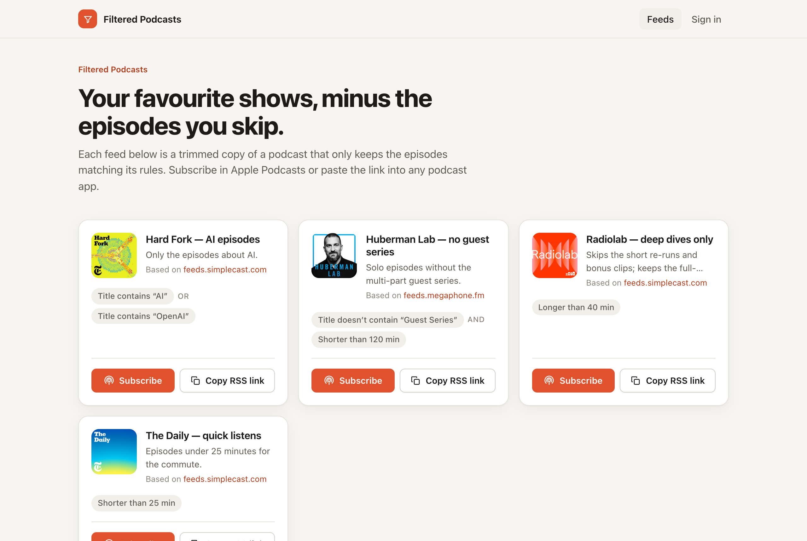
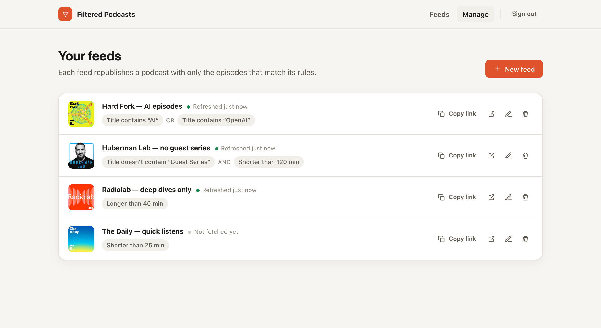
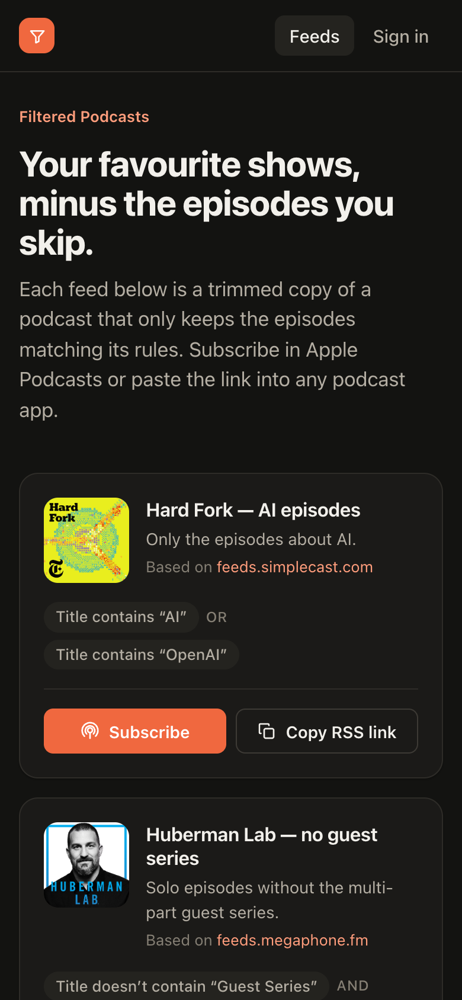
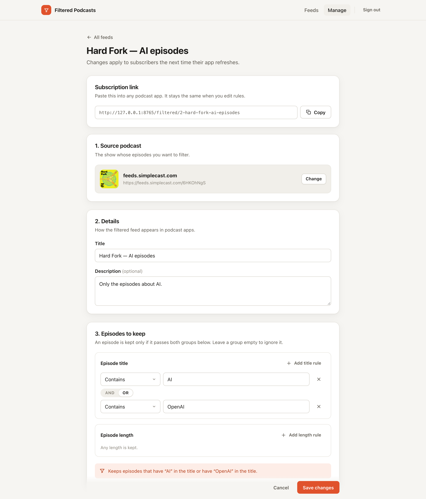

<div align="center">

# Filtered Podcasts

**Your favourite shows, minus the episodes you skip.**

Pick any podcast, describe which episodes you want to keep, and get a new RSS feed you can subscribe to in Apple Podcasts or any other podcast app.

   



</div>

## Why

Plenty of great shows mix the episodes you love with ones you never play: re-runs, bonus clips, multi-part series, three-hour specials. Podcast apps can't filter a feed for you, but they will happily subscribe to any RSS URL.

Filtered Podcasts sits in between. It reads the original feed, removes the episodes that don't match your rules, and republishes the result at a stable URL. Audio files still come straight from the original publisher, so nothing is re-hosted.

## Features

- **Rules in plain language.** Keep episodes by title ("contains *interview*", "doesn't contain *Guest Series*") and by length ("longer than 40 min"). Combine rules with AND / OR.
- **Find shows quickly.** Search the Apple Podcasts directory from the editor, or paste any RSS URL.
- **One-tap subscribe.** Every feed has a *Subscribe* button that opens Apple Podcasts, plus a *Copy RSS link* button for other apps.
- **Stable URLs.** Feeds live at `/filtered/{id}-{slug}`. Renaming a feed changes the slug, and old URLs `301`-redirect to the new one.
- **Cached output.** Generated XML is cached for 24 hours and cleared whenever you edit the feed.
- **Light and dark mode.** Responsive down to phone sizes.

<table>
  <tr>
    <td width="62%"></td>
    <td width="38%" rowspan="2"></td>
  </tr>
  <tr>
    <td></td>
  </tr>
</table>

## How the rules work

An episode is kept only if it passes **both** rule groups:

| Group | Conditions | Combine within group |
| --- | --- | --- |
| Episode title | contains · doesn't contain (case-insensitive) | AND / OR, evaluated left to right |
| Episode length | longer than · shorter than *N* minutes (from `itunes:duration`) | AND / OR, evaluated left to right |

An empty group is ignored. The editor shows a live sentence describing the result, e.g. *"Keeps episodes that have "AI" in the title or have "OpenAI" in the title, and are longer than 20 min."*

## Tech stack

| Layer | |
| --- | --- |
| Backend | PHP 8.4, Symfony 8, Doctrine ORM 3, SQLite |
| Frontend | React 19, React Router 7, TypeScript, Vite |
| Auth | Symfony form login (session), CSRF-protected JSON API |
| Directory search | iTunes Search API |

## Getting started

**Requirements:** PHP 8.4+ with `pdo_sqlite`, Composer, Node 20+ and pnpm.

```bash
composer install
pnpm install
pnpm build                                          # builds the SPA into public/app
php bin/console doctrine:migrations:migrate -n
php bin/console app:create-admin-user you@example.com 'a-strong-password'
symfony server:start                                # or: php -S 127.0.0.1:8000 -t public
```

Open http://127.0.0.1:8000, then **Sign in** to create your first feed.

While working on the frontend, run `pnpm build --watch` alongside the PHP server. Symfony serves the SPA from the built files in `public/app`, so the Vite dev server isn't used.

## Project structure

```
src/
  Controller/
    ApiController.php            # /api/bootstrap, /api/public/feeds
    Admin/PodcastFeedController  # /api/admin/feeds CRUD + directory search
    Admin/AdminSpaController     # serves the SPA for /admin/* routes
    PublicFeedController.php     # /filtered/{id}-{slug} → filtered RSS
  Service/
    FeedFilterService.php        # download, filter, rewrite and cache the RSS
    PodcastDirectorySearchService.php
    SourceFeedMetadataService.php
  Entity/                        # PodcastFeed, User
frontend/src/
  app/App.tsx                    # routes
  features/                      # catalog, auth, admin dashboard, feed editor
  components/                    # feeds/*, ui/*, layout/*
  lib/                           # API client, types, formatting helpers
  styles.css                     # design tokens + all styles
```

## API

| Method | Path | Auth |
| --- | --- | --- |
| `GET` | `/api/bootstrap` | public (current user + CSRF tokens) |
| `GET` | `/api/public/feeds` | public |
| `GET` | `/api/admin/feeds`, `/api/admin/feeds/{id}` | admin |
| `POST` / `PUT` / `DELETE` | `/api/admin/feeds[/{id}]` | admin + `X-CSRF-Token` |
| `GET` | `/api/admin/feeds/search/source?q=` | admin |
| `GET` | `/filtered/{id}-{slug}` | public RSS |

## Status and roadmap

The core flow works end to end. Before running this on the public internet, see the production checklist in [AGENTS.md](AGENTS.md#production-readiness). The main gaps are tests, login throttling, serving stale cache when the source is down, and deployment config.

Ideas that would add the most value next:

- An episode preview in the editor ("12 of 40 episodes kept") before saving
- A published/draft flag, so not every feed appears on the public page
- More rule types: publish date, season, explicit flag

## How this was built

This is a vibecoded app: it was built almost entirely by prompting AI coding agents, using a mix of [OpenAI Codex](https://openai.com/codex/) and [Claude Code](https://claude.com/claude-code), with a human steering, reviewing and testing. [AGENTS.md](AGENTS.md) holds the context those agents work from, so it's a good place to start if you want to keep building on it the same way.

## License

[MIT](LICENSE). Use it, fork it, and make it yours.
